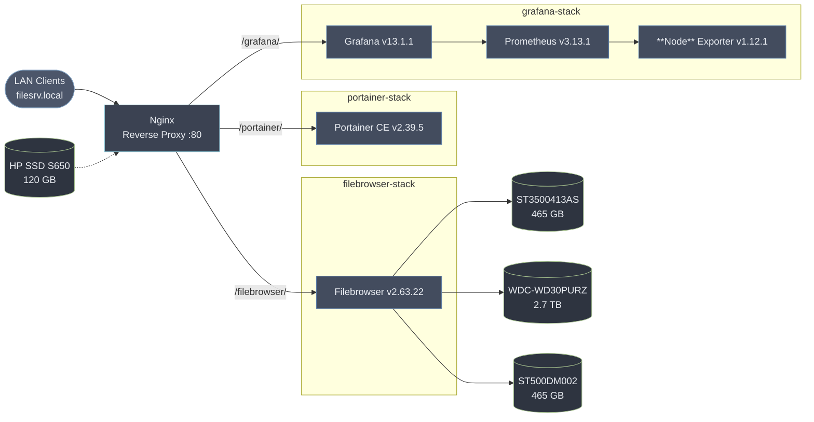
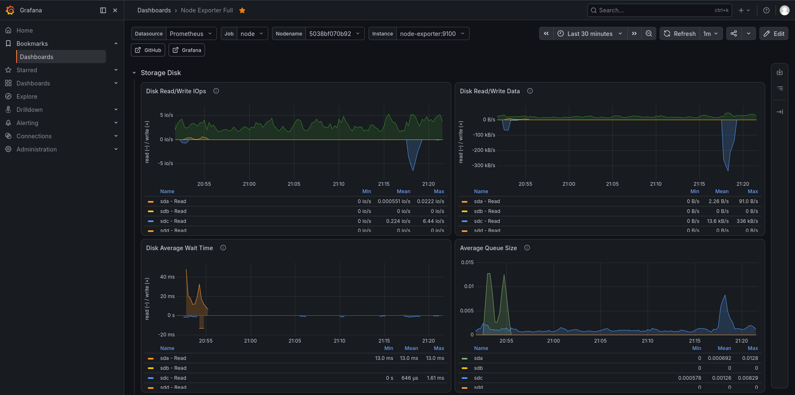
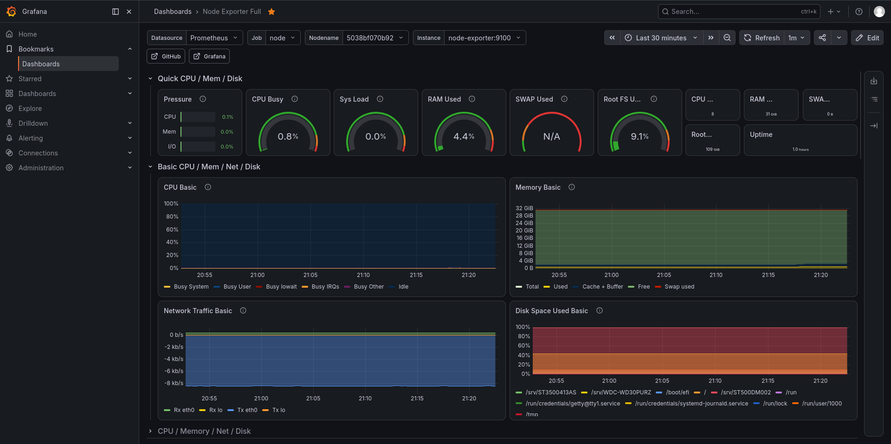
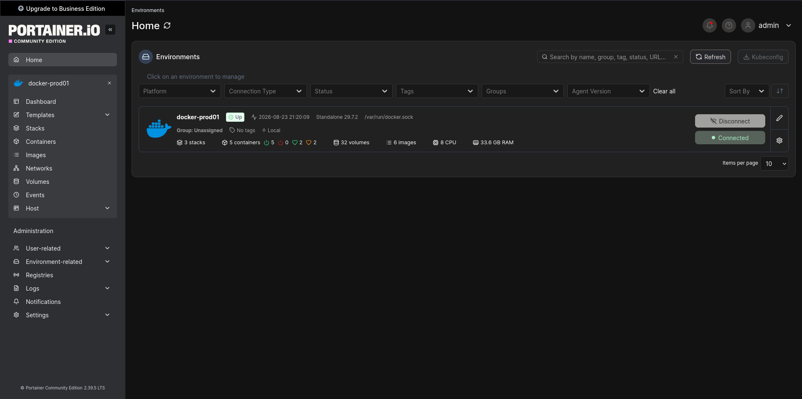
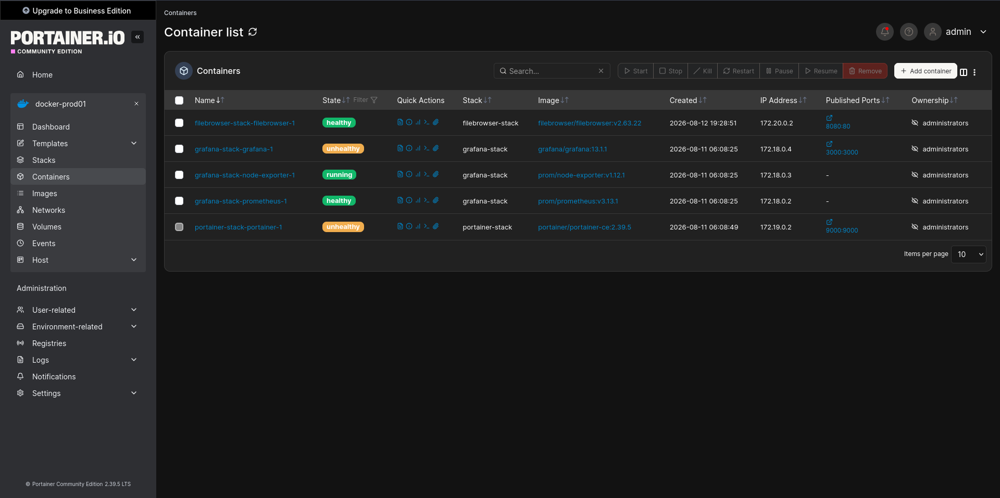

# filesrv.local


Personal file server running on repurposed physical hardware. Used for network-attached file storage.

## Overview

| Property     | Value                              |
| ------------ | ---------------------------------- |
| **Hostname** | `filesrv`                          |
| **OS**       | Debian GNU/Linux 13 (Trixie)       |
| **Kernel**   | Linux 6.12.101+deb13-amd64         |
| **Local IP** | `192.168.0.107` (DHCP reservation) |
| **Domain**   | `filesrv.local` (mDNS via Avahi)   |

## Hardware

| Component  | Details                                          |
| ---------- | ------------------------------------------------ |
| **Model**  | HP Compaq 6200 Pro SFF PC                        |
| **CPU**    | Intel Xeon E3-1230 @ 3.20 GHz (4C/8T)            |
| **RAM**    | 32 GiB                                           |
| **Swap**   | None                                             |
| **OS disk**| HP SSD S650 120G (`/dev/sdc`) — `/` + `/boot/efi`|

### Storage disks

Mounted individually under `/srv/` and bind-mounted into the `filebrowser` container:

| Disk                 | Size   | Partition Table | Mountpoint |
| -------------------- | ------ | --- | ------------------- |
| Seagate ST3500413AS  | 465 GB | GPT | `/srv/ST3500413AS`  |
| WD WD30PURZ (Purple) | 2.7 TB | GPT | `/srv/WDC-WD30PURZ` |
| Seagate ST500DM002   | 465 GB | GPT | `/srv/ST500DM002`   |

## Architecture



## Services

| Service        | Status    | Description                         |
| -------------- | --------- | ----------------------------------- |
| **Nginx**      | ✅ Active | Reverse proxy                       |
| **Docker**     | ✅ Active | Container runtime                   |
| **Fail2ban**   | ✅ Active | SSH brute-force protection (`sshd` jail) |
| **Firewalld**  | ✅ Active | Zone-based firewall (nftables)      |
| **AppArmor**   | ✅ Active | Mandatory access control            |
| **SSH**        | ✅ Active | Remote access                       |
| **Avahi**      | ✅ Active | mDNS / `.local` name resolution     |
| **Cron**       | ✅ Active | Scheduled tasks                     |

## Docker Stack — Filebrowser

Located at `/opt/filebrowser-stack/`. Managed with Docker Compose. Serves the three physical storage disks through a web UI.

| Container     | Image                             | Port (loopback)   |
| ------------- | --------------------------------- | ----------------- |
| `filebrowser` | `filebrowser/filebrowser:v2.63.22`| `127.0.0.1:8080`  |

Filebrowser is accessible at `http://filesrv.local/filebrowser/` (proxied via Nginx).

## Docker Stack — Monitoring

Located at `/opt/grafana-stack/`. Managed with Docker Compose.

| Container       | Image                        | Port (loopback)  |
| --------------- | ---------------------------- | ---------------- |
| `grafana`       | `grafana/grafana:13.1.1`     | `127.0.0.1:3000` |
| `prometheus`    | `prom/prometheus:v3.13.1`    | internal (9090)  |
| `node-exporter` | `prom/node-exporter:v1.12.1` | internal (9100)  |

Grafana is accessible at `http://filesrv.local/grafana/` (proxied via Nginx, `GF_SERVER_SERVE_FROM_SUB_PATH=true`).

## Docker Stack — Portainer

Located at `/opt/portainer-stack/`. Managed with Docker Compose.

| Container   | Image                          | Port (loopback)   |
| ----------- | ------------------------------ | ----------------- | 
| `portainer` | `portainer/portainer-ce:2.39.5`| `127.0.0.1:9000`  |

Portainer is accessible at `http://filesrv.local/portainer/` (proxied via Nginx).

## Nginx

Config: [`etc/nginx/sites-available/filesrv.local`](etc/nginx/sites-available/filesrv.local)

* Reverse-proxies `/grafana/`, `/portainer/`, and `/filebrowser/` to their respective loopback-bound containers
* WebSocket support enabled for Grafana live features and Portainer
* `server_tokens off` — version not exposed

## Security

* **Firewalld** — zone-based; `public` zone (default, active) allows `dhcpv6-client http https mdns ssh`; a dedicated `docker` zone (active) isolates the Compose bridge networks
* **Fail2ban** — one active jail: `sshd`
* **AppArmor** — mandatory access control profiles

Open ports (host-level):

| Port | Protocol | Service      |
| ---- | -------- | ------------ |
| 22   | TCP      | SSH          |
| 80   | TCP      | Nginx (HTTP) |
| 5353 | UDP      | Avahi mDNS   |

> All Docker services (Grafana, Portainer, Filebrowser) are bound to `127.0.0.1` only and reached exclusively through the Nginx reverse proxy.

## Screenshots

### Grafana




### Portainer



## Repository Structure

```
filesrv/
├── README.md
├── .gitignore
├── screenshots/
│   ├── grafana-metrics.png
│   ├── grafana-dashboard.png
│   ├── portainer-containers.png
│   └── portainer-environments.png
├── etc/
│   └── nginx/
│       └── sites-available/
│           └── filesrv.local
└── opt/
    ├── grafana-stack/
    │   ├── compose.yaml
    │   ├── prometheus/
    │   │   └── prometheus.yml
    │   └── grafana/
    │       └── provisioning/
    │           ├── datasources/
    │           │   └── prometheus.yml
    │           └── dashboards/
    │               └── dashboards.yml
    ├── portainer-stack/
    │   └── compose.yaml
    └── filebrowser-stack/
        └── compose.yaml
```

## Notes

* Secrets (`*_admin_password.txt`) are stored in each stack's `secrets/` directory — **not tracked** in this repo.
* TLS/HTTPS is a known gap — not yet implemented.
